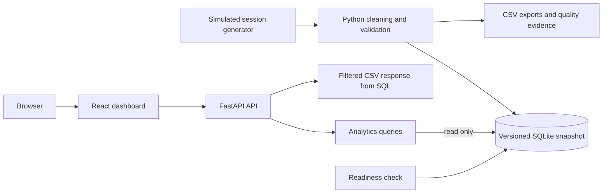

# PressLens architecture

PressLens is a publishing analytics portfolio project. Its current data is simulated and is intended to demonstrate a reproducible analysis workflow, not describe the performance of The Economic Times or any other publisher.

The application uses a modular Python service and a React client. One deployable container serves the API and the compiled web application. A deterministic pipeline prepares a local SQLite snapshot before the application starts.

## Boundaries

| Boundary | Responsibility |
| --- | --- |
| Data pipeline | Generate the demonstration input, clean and validate records, then write the analytical snapshot and exportable data. |
| Analytics | Define metric calculations, SQL aggregation, filtering, and the response contract. |
| HTTP API | Validate query parameters, expose analytics and downloads, and report service health. |
| Web application | Present filters, metrics, comparisons, and explanations of the data. |
| Deployment | Package a matching frontend, API, and demonstration snapshot in one immutable container image. |

Module boundaries make the calculation and data preparation code testable without a browser. They are not independently deployed services. There is no message broker, cache cluster, production data warehouse, or background ingestion service in this release.

## Request and data lifecycle

1. During the image build, `python -m presslens.pipeline --output-dir /app/data/demo` generates the demonstration snapshot.
2. At startup, `PRESSLENS_DATABASE_PATH` points the service to that snapshot; `WEB_DIST` selects the compiled React application.
3. A browser request supplies the chosen filters. The API validates those values and runs parameterized analytical queries.
4. The browser receives aggregate results and renders the dashboard. The CSV endpoint queries the same filtered population in SQLite. Raw CSVs and quality files are offline pipeline artifacts, not public download routes.
5. Changing the demonstration data requires a new pipeline run and deployment. Serving traffic does not mutate the snapshot.

The SQLite connection should open the database in read-only mode. Container-level read-only mounts provide an additional operational control in the Compose configuration. The pipeline runs during build or as an explicit development command, never as a side effect of an analytics request.

## Operational contract

- `GET /health/live` reports whether the HTTP process can respond.
- `GET /health/ready` checks that the database schema is supported, the snapshot can be queried, and the compiled frontend's `index.html` exists. Render uses this endpoint to gate routing.
- The server listens on `0.0.0.0` and the platform's `PORT` value, falling back to `8000` for local use.
- The application process runs as an unprivileged container user.
- No credentials are required to generate or serve the simulated data.
- A snapshot change and code change travel together in the built image. Rollback means redeploying a previously verified image or commit.

## Scope and limits

This is a demonstration of SQL, Python, analytical reasoning, and dashboard delivery. It does not prove causal effects of channels or content, measure real publisher revenue, or predict subscription behavior. Comparisons are descriptive and may reflect differences in the simulated audience mix.

SQLite is suitable for this small, immutable analytical dataset. Concurrent ingestion, access-controlled customer data, large history, or operational writes would change the storage requirements; those are future design decisions, not implemented infrastructure.

See [the modular monolith decision](adr/001-modular-monolith.md), [the snapshot decision](adr/002-read-only-sqlite.md), [the data contract](data-model.md), and [the deployment runbook](deployment.md).
