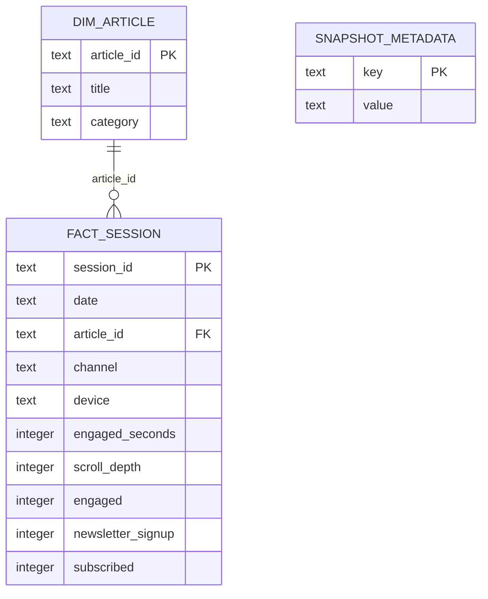

# Data model and analytical contract

The demonstration starts with **simulated reading sessions**. These are fabricated records for a portfolio project. They are not user tracking data, publisher records, or observations of The Economic Times audience.

## Source grain

One accepted session record represents one simulated reading session associated with its event date, article/category, and acquisition channel. Session identifiers support duplicate detection. Article identifiers and category labels support editorial comparisons; channel labels support acquisition comparisons.

Session counts must not be relabelled as unique readers unless the data has a separate stable reader identifier and the query explicitly counts it. A subscription indicator is a simulated outcome attributed to a session; it is not a verified customer, transaction, or amount of revenue.

## Physical schema

| Object | Grain and meaning |
| --- | --- |
| `fact_session` | One accepted session. The primary key is `session_id`; `article_id` references the article catalog. |
| `dim_article` | One fictional article with its title and editorial category. |
| `snapshot_metadata` | JSON metadata under `meta` and `quality` keys, including schema version, generator seed, source SHA-256, date range, metric definitions, and quality counts. |
| `mart_daily` | SQL view grouped by event date, with session, engagement, subscription, and rate aggregates. |
| `mart_article` | SQL view grouped by article, with descriptive dimensions and count aggregates. |

All tables use SQLite strict typing. `fact_session` constrains channels to Search, Direct, Social, Newsletter, and Referral; devices to Desktop, Mobile, and Tablet; engaged time to 0–3,600 seconds; scroll depth to 0–100%; and event flags to 0 or 1. `engaged` must agree with the engagement rule below. Subscription and newsletter events require an engaged session in this demonstration model.

The schema creates indexes on date, channel/date, article ID, and article category. These support the dashboard's main filter and grouping paths; their existence is not a substitute for measuring query performance on a larger dataset.

## Processing layers

| Layer | Purpose | Review evidence |
| --- | --- | --- |
| Generated input | Create a reproducible demonstration with documented generation assumptions. | Generation configuration and source record count. |
| Clean records | Normalize values and apply validation and duplicate rules. | Counts of accepted, rejected, changed, and duplicate records where the pipeline reports them. |
| SQLite snapshot | Serve the accepted records through SQL aggregates. | Schema, SQL statements, dataset version, and reconciliation checks. |
| Exported CSV | Let a reviewer inspect records with Python, Excel, or Google Sheets. | Header definitions and row counts matching the relevant export scope. |

The pipeline writes `raw_sessions.csv`, `sessions.csv`, `articles.csv`, `rejected_sessions.csv`, `quality.json`, and `presslens.sqlite`. The rejected export records `source_line` and `rejection_reason` so a reviewer can inspect exclusions. The pipeline stages outputs in a temporary directory and replaces the SQLite file last. The serving process reads the database; production updates use a new container image rather than running the pipeline in place.

Cleaning trims string fields, normalizes recognized channel/device case, validates identifiers and ISO event dates, checks article references and numeric bounds, and checks the stated event rules. It retains the first **valid** occurrence of each session identifier. Invalid records are quarantined; metric values are not imputed. The quality output reconciles raw rows with accepted plus rejected rows and reports normalization and rejection counts.

The executable schema and pipeline are the authoritative field definitions. When fields or cleaning rules change, update them and the metric tests together. Do not describe a generated input issue as an observed defect in real customer data.

## Metric rules

- **Sessions:** the number of accepted session records in the selected scope.
- **Engaged session:** at least 30 engaged seconds **and** at least 50% scroll depth.
- **Engagement rate:** engaged sessions divided by all accepted sessions in the selected scope.
- **Average engaged seconds:** the sum of engaged seconds divided by all accepted sessions, including sessions with zero engaged seconds.
- **Subscriptions:** the sum/count of the simulated subscription outcome in the selected scope.
- **Subscription conversion:** subscription outcomes divided by all accepted sessions in that same scope. Show an explicit empty state when the denominator is zero.
- **Channel and editorial comparisons:** aggregate by the selected dimension using the same filter scope and denominator definitions as the headline metrics.

Never average precomputed group percentages to produce an overall conversion rate. Recompute the ratio from numerator and denominator totals. Comparisons should show their supporting session counts so a small group does not appear equally reliable to a large one.

## Time and filtering

The `date` field is an ISO `YYYY-MM-DD` event date, not a timestamp. It carries no time-zone information. Date bounds are inclusive. Category, channel and device selections use exact-match bound SQL parameters; unknown values return an empty population. Invalid dates and reversed bounds are rejected with HTTP 422.

A filtered download should make its scope clear in the interface or filename. A full source-data download should be labelled as the full dataset. These are different artifacts and should not silently interchange.

## Quality checks

The data tests should establish unique session identifiers after cleaning, valid dates and supported dimensions, valid numeric ranges, and valid subscription indicators. Reconcile the overall session count and outcomes between the clean records, SQLite snapshot, and exported data. Check boundary and empty-filter cases in the API.

Only report a check as passed after running it. Dataset size and numerical results in a release description must come from the current generated outputs rather than from a previous version of the site.

## Interpretation limits

The data is intentionally simulated and may encode relationships from its generator. A high conversion rate is not causal evidence that a channel or editorial topic improves subscriptions. The project demonstrates how to formulate and inspect a business question; a real publisher would need governed source data, sampling checks, experiment design, and operational context before making a decision.
